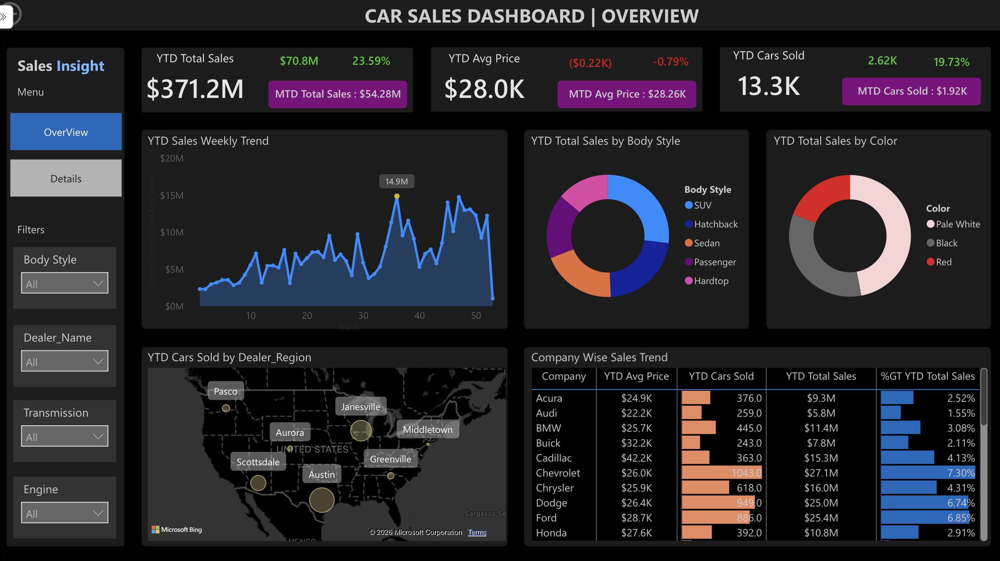
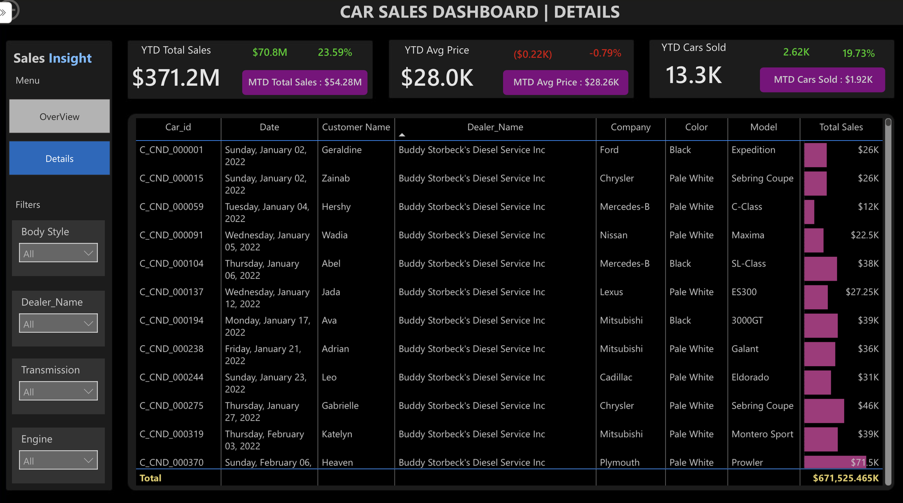

# 🚗 Car Sales Analysis — Power BI Dashboard

An interactive Power BI dashboard that tracks car sales performance with year-to-date (YTD), month-to-date (MTD) and year-over-year (YoY) KPIs, broken down by company, body style, color, region and dealer.



---

## 📌 Project Goals

- Monitor **total sales**, **average price** and **cars sold** for the current year.
- Compare performance against the **previous year** (YoY growth and difference).
- Spot **weekly sales trends** and peak weeks.
- Identify the best-performing **companies, body styles, colors and dealer regions**.
- Drill into **individual transactions** for detailed review.

## 🛠️ Tools

| Tool | Used for |
|------|----------|
| Power BI Desktop | Data modeling, DAX measures, visualization |
| Power Query | Data cleaning and transformation |
| DAX | Time-intelligence KPIs (YTD, MTD, YoY) |

## 📊 Dashboard Pages

### 1. Overview
- **KPI cards** for YTD Total Sales, YTD Average Price and YTD Cars Sold, each showing the difference vs. last year, YoY growth % and an MTD indicator.
- **YTD Sales Weekly Trend** (area chart) with the peak week highlighted.
- **Sales by Body Style** and **Sales by Color** (donut charts).
- **Cars Sold by Dealer Region** (map).
- **Company-wise Sales Trend** table (avg price, cars sold, total sales).

### 2. Details
- The same KPI cards for context.
- A transaction-level table: car ID, date, customer, dealer, company, model, color and sales amount.

**Filters on both pages:** Body Style · Dealer Name · Transmission · Engine



## 🧮 Key DAX Measures

See [`docs/measures.md`](docs/measures.md) for the full list. Highlights:

- `YTD Total Sales`, `YTD Avg Price`, `YTD Cars Sold`
- `YoY Sales Growth`, `YoY Avg Price Growth`, `YoY Cars Sold Growth`
- `Sales Difference`, `Avg Price Difference`, `Cars Sold Difference`
- `MTD KPI`, `MTD Avg Price KPI`, `MTD Cars Sold KPI`
- `Max Point` — flags the peak week on the trend chart

## 🗂️ Data Model

| Table | Description |
|-------|-------------|
| `car_data` | One row per sale: car ID, date, customer, dealer, dealer region, company, model, engine, transmission, color, body style, price |
| `Calender_Table` | Date dimension used for weekly trends and time-intelligence measures |

## 💡 Key Insights

- **Total Sales:** The dashboard reports $371.2M in year-to-date sales across approximately 13,300 vehicles.
- **Sales Growth:** Year-to-date sales increased by 23.59%, while the number of vehicles sold grew by 19.73%.
- **Average Selling Price:** The average vehicle price was approximately $28,000, representing a 0.79% decline.
- **Vehicle Preferences:** SUVs generated the largest share of sales among the five body styles displayed.
- **Company Performance:** Chevrolet generated approximately $27.1M in year-to-date sales, the highest among the companies visible in the dashboard table.

## 📁 Repository Structure

```
Car_sales_analysis/
├── report/
│   └── Car_Sales_Dashboard.pbix   # Power BI report
├── data/                          # Source dataset (see data/README.md)
├── images/                        # Dashboard screenshots
├── docs/
│   └── measures.md                # DAX measure reference
└── README.md
```

## ▶️ How to Use

1. Install [Power BI Desktop](https://powerbi.microsoft.com/desktop/) (free, Windows).
2. Clone this repository or download it as a ZIP.
3. Open `report/Car_Sales_Dashboard.pbix`.
4. Use the slicers and page navigator to explore.

## 👤 Author

**Saxi Patel** — [GitHub](https://github.com/saxipatel)
